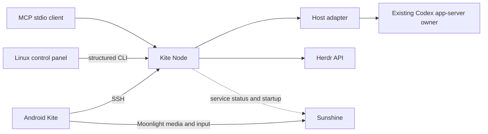

# Linux desktop host

Kite's Linux desktop host includes a persistent Rust **Kite Node** and a native GTK control panel. Closing the panel leaves the node, agent owners and external services running. This guide covers the delivered **host** stage. The [desktop product](desktop.md) also requires a client that connects to other desktop machines; that client is the next desktop stage. Durable multi-machine messaging is tracked separately.

## Install and enable

Download the Linux x86_64 archive from the same [Alpha release](https://github.com/wenshiqi0/Kite/releases) as Android and check it against `SHA256SUMS`. The package targets GNU/Linux x86_64, built on Ubuntu 24.04. Bun 1.3.14+, GTK 3, a systemd user manager, Herdr and Sunshine must already be installed. Linux X11 is the current supported capture path.

```sh
tar -xzf kite-host-0.2.0-alpha.61-linux-x86_64.tar.gz
cd kite-host-0.2.0-alpha.61-linux-x86_64
bun install.js --enable
~/.local/bin/kite-node status
~/.local/bin/kite-desktop
```

Install as the desktop/SSH user without sudo. The standalone `install.js` and all Linux distribution/QA tooling use Bun; no Python interpreter is required by the Linux host package. The installer checks the binary against `host-manifest.json`, installs a desktop-menu entry and enables `kite-node.service`. Private configuration is at `~/.config/kite/node.json`. Its Unix socket defaults to `~/.local/state/kite/node/host.sock`, mode 0600 in a private directory. External access uses existing SSH authentication; no public API port or provider credentials are added.

Default service references are `herdr.service` and `app-dev.lizardbyte.app.Sunshine.service`. Active services are reused without changing their processes or configuration. For custom unit/executable names, edit the corresponding configuration fields and restart only `kite-node.service`. **Start host services** starts configured inactive services; the panel does not stop external services. **Close panel** only closes the GUI.

Alpha 17+ requires the live node. There is no automatic Python-direct fallback. Keep the same phone key, host address/port, trust and Sunshine pairing. Node installs `~/.local/lib/kite/host.js` and continues using the existing session catalogue, provider references, histories, owner registry and recovery leases. Earlier adapter files are left unchanged. Production sessions are not migrated to herdr-core.

Host agent notifications and optional private FCM sender configuration are documented in [Agent notifications](notifications.md).

## Taskbar status

The status polling, action handling and upgrade refinements below describe the current source revision; they have not yet been published in an Alpha package.

Alpha 19 adds a resident icon in the X11 notification area. Green/check means the node is reachable and every configured service is active; amber/exclamation means a service is inactive or could not be inspected; red/cross means the node could not be reached. A clock badge indicates startup or a pending action. Tooltip text and the context menu show individual service states. These report local service health, rather than an established phone connection or a successful model/streaming request.

Left-click opens the existing management window. Right-click offers **Open panel**, **Start host services**, **Refresh** and **Exit status UI (keep background services)**. Closing the panel hides it into the tray. Both surfaces share one poll: every three seconds with a visible window, or fifteen seconds while hidden. Hidden windows skip widget updates; unchanged service rows are reused. Failure clears the previous healthy state. A slow response is shown separately from an unreachable node. Relaunching Kite reuses the same GUI instance.

Node inspects all configured units with one bounded `systemctl show` call and shares a three-second cache across status clients. Manual **Refresh** bypasses the cache; concurrent refreshes share an in-progress inspection. Service inspection has a four-second deadline, status RPC five seconds and the UI six seconds. An inspection failure marks the service state unknown and includes a diagnostic, rather than claiming the service has stopped.

Health queries continue during user actions. Distinct actions queue in order, duplicate pending actions coalesce, and repeated manual refreshes combine into one follow-up query. A failed action stays visible through successful health polls until dismissed or successfully retried.

The installer creates `~/.config/autostart/io.github.wenshiqi0.Kite.desktop`, running `kite-desktop --background` at graphical login. Disable it in the desktop's startup settings or set `Hidden=true` in that file. Existing autostart preferences are preserved on upgrade. `kite-node.service` is independent of the graphical login and icon. `kite-desktop --quit` exits only the status UI.

With `--enable`, installation compares the running executable through `/proc/<pid>/exe` with the package digest and verifies the listener's version and executable before completing. Retrying an interrupted installation therefore detects a still-running old Node even after its installed symlink changed. Existing node configuration and autostart preferences are preserved.

The current source adds **live Node handover**, described in [RFC 0018](rfcs/0018-live-node-upgrade.md). `kite-node.socket` owns the listener. The new generation prepares its adapter and state before taking over new connections; the old generation retains every accepted connection and exits after those connections finish. A short-lived launcher lets the user manager adopt the replacement before MAINPID changes, so the manager can detect and recover a replacement crash while old connections remain open. The installer uses `kite-node upgrade --binary PATH` instead of restarting an already-capable Node. API 1 and backend protocol 5 are required; incompatible or unready candidates leave the old generation serving. Notifications and push registrations drain before state ownership changes, and adapters are pinned by source digest so old connections keep matching code. The GUI receives an update hint and waits for a hidden, idle tray panel, or a normal exit/next launch without a tray. The installer never forces an open panel to close.

**First migration is a maintenance operation.** A running older Node without `liveUpgrade` support is rejected before installed files change. Use `bun install.js --enable --migrate-node` during an intentional maintenance window to adopt socket activation; that one-time switch reconnects existing clients. There is no silent restart fallback. Ordinary `systemctl restart`, process crashes, host reboot, incompatible protocol/schema changes and actual phone/model/media acceptance remain separate from live-upgrade claims. The local test build is now deployed on wen.linux; [local deployment acceptance](product/2026-11-01/live-node-upgrade/deployment.json) records a real Codex turn through two compatible upgrades and the remaining mobile/media scope. It has not been published as a new package.


Tray support currently targets Xfce/X11, using GTK 3's X11 notification-area adapter. Without a tray, the management window opens automatically; closing it exits the GUI and leaves Node running. Wayland/GNOME tray integration remains pending. [RFC 0014](rfcs/0014-linux-host-node.md) records the platform boundary.

## Agent desktop access and docs

The current source installs `kite` alongside `kite-node`. `kite docs` and `kite docs desktop` work offline and are the shared entry for shell-capable agents. Status, native PNG/crop capture, pointer/button/scroll, complete key chords, UTF-8 stdin text and argv app launch use `kite desktop`; only the configured X11 target is selected. Input requires `xdotool`; capture requires libX11. A matching graphical session supplies launch environment, while Node supervisor and unrelated agent identities are removed.

```sh
bun install.js --enable --skill-dir ~/.agents/skills --skill-dir ~/.claude/skills
kite docs desktop
kite desktop status
kite desktop screenshot
```

`--skill-dir` is optional and accepts any harness discovery root. The same standard `kite/SKILL.md` is installed into each; locally edited bundles are preserved rather than overwritten. No harness configuration or approval policy is changed. Codex and DeepSeek Harness can discover shared `.agents/skills`; Claude has its own discovery root. They remain consumers of CLI/MCP, not newly implemented chat providers. The package carries the Skill; Markdown bodies are embedded once in the binary and queried on demand. See [harness integration](agent/harnesses.md).

The MCP tools are `kite_host_status`, `kite_sessions_list`, `kite_docs` and `kite_desktop`. Docs return only requested bodies; explicit known revisions omit unchanged content. A missing body after context compaction must be fetched again. Desktop screenshots use standard image blocks, including crop origin and SHA, and identical explicitly known captures omit the image. Consumers without image support must use their image viewer or report the limitation. Desktop input/launch modifies actual apps and requires the current task's authorization.

## Connection paths



## MCP and diagnostics

Run `~/.local/bin/kite-node mcp` locally or use `ssh YOUR_HOST ~/.local/bin/kite-node mcp` as an MCP client's command. Protocol revision is 2025-11-25. Host queries use `kite_host_status` and `kite_sessions_list` without starting a model turn; `kite_docs` and `kite_desktop` add the agent documentation/desktop contract described above. Shell-string execution, model-to-model delivery and durable cross-machine tasks are not exposed by this first stage. Stdout contains JSON-RPC only.

```sh
systemctl --user status kite-node.service
journalctl --user -u kite-node.service -n 60 --no-pager
~/.local/bin/kite-node api-version
~/.local/bin/kite-node sessions
```

Expected node API is 1 and adapter protocol is 5. A phone asking to enable the desktop host needs Node running under its SSH user. Service presence, private IPC, provider chat and actual desktop streaming are distinct acceptance boundaries.
