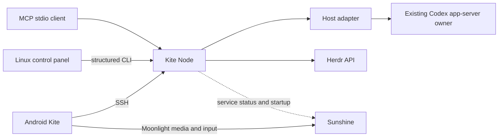

# Linux desktop host

Kite's Linux desktop host includes a persistent Rust **Kite Node** and a native GTK control panel. Closing the panel leaves the node, agent owners and external services running. This is the desktop **host** stage; a desktop remote-viewing client and durable multi-machine messaging remain separate stages.

## Install and enable

Download the Linux x86_64 archive from the same [Alpha release](https://github.com/wenshiqi0/Kite/releases) as Android and check it against `SHA256SUMS`. The package targets GNU/Linux x86_64, built on Ubuntu 24.04. Python 3, GTK 3, a systemd user manager, Herdr and Sunshine must already be installed. Linux X11 is the current supported capture path.

```sh
tar -xzf kite-host-0.2.0-alpha.19-linux-x86_64.tar.gz
cd kite-host-0.2.0-alpha.19-linux-x86_64
python3 install.py --enable
~/.local/bin/kite-node status
~/.local/bin/kite-desktop
```

Install as the desktop/SSH user without sudo. The installer checks the binary against `host-manifest.json`, installs a desktop-menu entry and enables `kite-node.service`. Private configuration is at `~/.config/kite/node.json`. Its Unix socket defaults to `~/.local/state/kite/node/host.sock`, mode 0600 in a private directory. External access uses existing SSH authentication; no public API port or provider credentials are added.

Default service references are `herdr.service` and `app-dev.lizardbyte.app.Sunshine.service`. Active services are reused without changing their processes or configuration. For custom unit/executable names, edit the corresponding configuration fields and restart only `kite-node.service`. **Start host services** starts configured inactive services; the panel does not stop external services. **Close panel** only closes the GUI.

Alpha 17+ requires the live node. There is no automatic Python-direct fallback. Keep the same phone key, host address/port, trust and Sunshine pairing. Node installs `~/.local/lib/kite/backend-v5.py` and continues using the existing session catalogue, provider references, histories, owner registry and recovery leases. Earlier adapter files are left unchanged. Production sessions are not migrated to herdr-core.

## Taskbar status

Alpha 19 adds a resident icon in the X11 notification area. Green/check means the node is reachable and every configured service is active; amber/exclamation means a service is inactive or could not be inspected; red/cross means the node could not be reached. A clock badge indicates startup or a pending action. Tooltip text and the context menu show individual service states. These report local service health, rather than an established phone connection or a successful model/streaming request.

Left-click opens the existing management window. Right-click offers **Open panel**, **Start host services**, **Refresh** and **Exit status UI (keep background services)**. Closing the panel hides it into the tray. Both surfaces share a three-second poll with a three-second timeout; failure clears the previous healthy state. Relaunching Kite reuses the same GUI instance.

The installer creates `~/.config/autostart/io.github.wenshiqi0.Kite.desktop`, running `kite-desktop --background` at graphical login. Disable it in the desktop's startup settings or set `Hidden=true` in that file. Existing autostart preferences are preserved on upgrade. `kite-node.service` is independent of the graphical login and icon. `kite-desktop --quit` exits only the status UI.

Tray support currently targets Xfce/X11, using GTK 3's X11 notification-area adapter. Without a tray, the management window opens automatically; closing it exits the GUI and leaves Node running. Wayland/GNOME tray integration remains pending. [RFC 0014](rfcs/0014-linux-host-node.md) records the platform boundary.

## Connection paths



## MCP and diagnostics

Run `~/.local/bin/kite-node mcp` locally or use `ssh YOUR_HOST ~/.local/bin/kite-node mcp` as an MCP client's command. Protocol revision is 2025-11-25. Tools are `kite_host_status` and `kite_sessions_list`; they query the local host without starting a model turn. Arbitrary shell execution, model-to-model delivery and durable cross-machine tasks are not exposed by this first stage. Stdout contains JSON-RPC only.

```sh
systemctl --user status kite-node.service
journalctl --user -u kite-node.service -n 60 --no-pager
~/.local/bin/kite-node api-version
~/.local/bin/kite-node sessions
```

Expected node API is 1 and adapter protocol is 5. A phone asking to enable the desktop host needs Node running under its SSH user. Service presence, private IPC, provider chat and actual desktop streaming are distinct acceptance boundaries.
