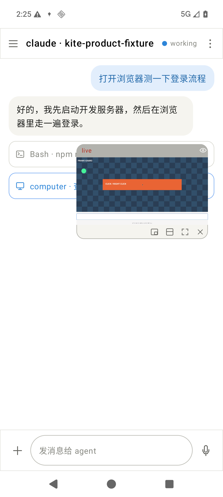
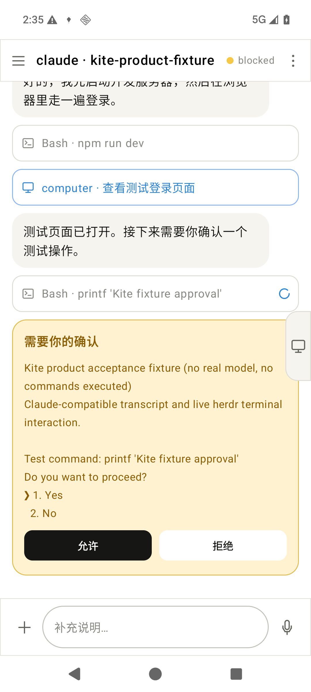
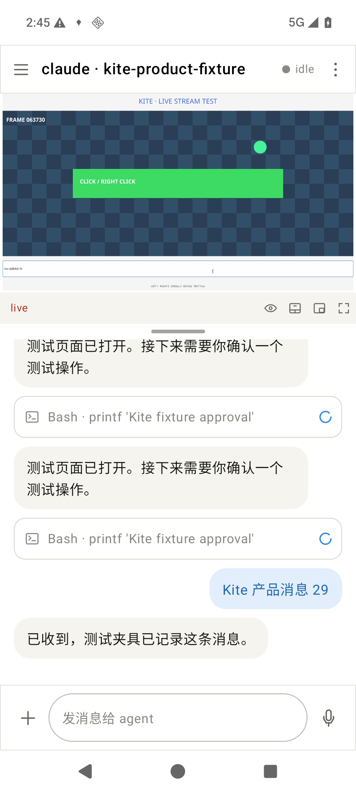
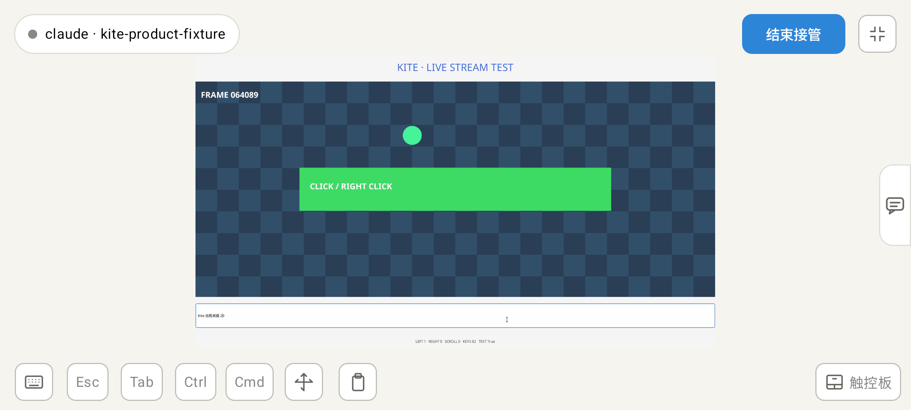
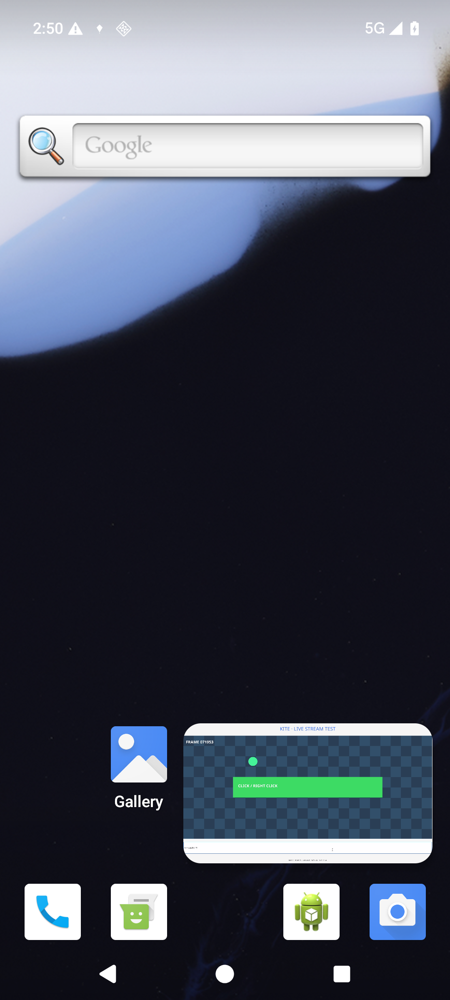
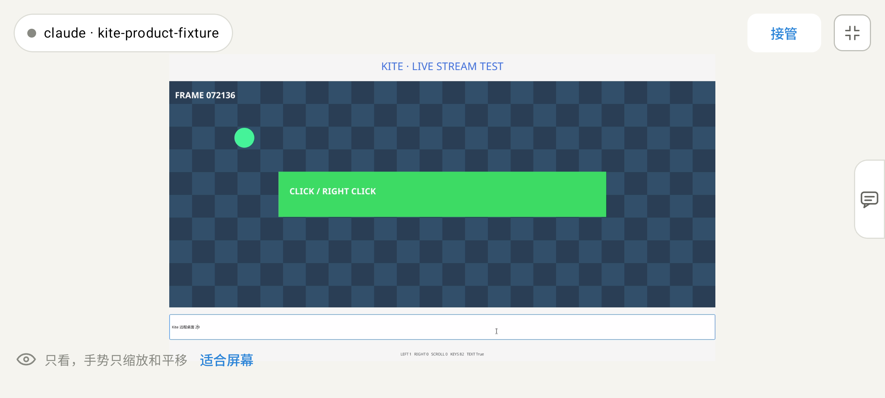

# Android Alpha 2 acceptance

Validated on 2026-10-29 with an ARM64 API 36 emulator, an actual Linux X11 SSH host, herdr 0.9.5 and Sunshine v2026.914.233613 over LAN. The host source and decoder remained **1920×1080** with a 60fps stream request and a 50Hz host desktop. Requested FPS is not a measured presentation rate.

The agent shown below is a clearly labelled [controlled fixture](../../../crates/kite-app/examples/product_agent_fixture.py). It writes standard Claude records and uses real herdr session metadata, prompt / key routing and Linux process groups. The remote [GTK fixture](../../../crates/kite-app/examples/desktop_fixture.py) records input counters and the exact Unicode test-text match. No model is invoked, and illustrative shell commands are never executed.

| Flow | Observed result |
| --- | --- |
| Conversation | Structured user / assistant bubbles and linked tool cards; Chinese prompt acknowledged through the selected public herdr pane and returned in history |
| Approval | Actual Yes / No terminal choices receive one confirmation; stale session, status or prompt is rejected by Rust tests |
| Floating desktop | Live video, draggable header, edge docking and restoration; watch touch does not reach host |
| Split / fullscreen | Divider changes video bounds, composer remains available; landscape opens watch mode |
| Takeover | Host receives a click while agent heartbeat continues; Chinese keyboard input reaches the GTK entry, trackpad motion adds no click |
| Independent pause | Verified agent and shell groups stop while video continues; saved identity survives app restart and resume restores terminal foreground |
| System PiP | Android reports a pinned task and mediaPlayback service; video continues without app chrome; launcher return preserves the same PID and one decoder configuration, with takeover released |

The final build also rechecked pause / resume after reconciliation locking changed, and PiP return after fixing an unintended drawer opening. [Machine-readable results](acceptance/results.json) include screenshot hashes.

Build verification: **35 Rust tests passed**, Clippy with warnings denied, rustfmt, Android Debug assembly and lint, workflow actionlint, and ARM64 iOS simulator compilation. Android JVM tests have no sources; iOS compilation does not establish iOS desktop support. Signed Release assembly, Release lint and artifact verification run separately in tagged CI.

These are emulator and controlled-fixture observations. They do not establish real-model task completion, physical-phone or WAN latency, voice-recognition quality, or all provider approval prompt variants.

## Captures

Chat with floating desktop:

Blocked approval with desktop docked:

Portrait split after dragging the divider:

Fullscreen takeover:

Android system picture-in-picture:

Returning to watch mode:

