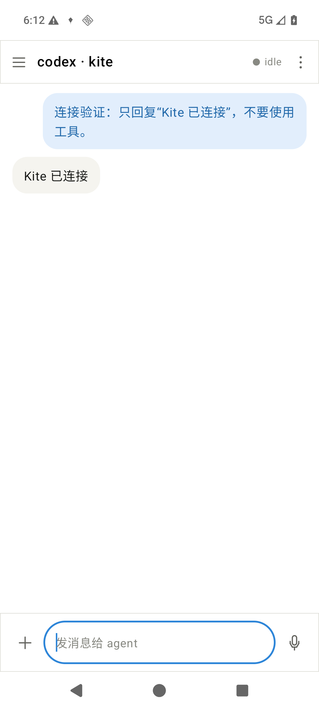
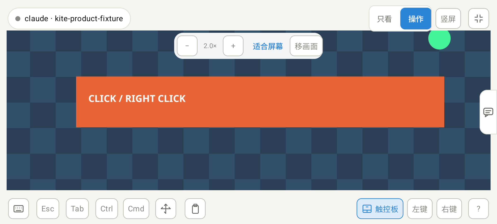
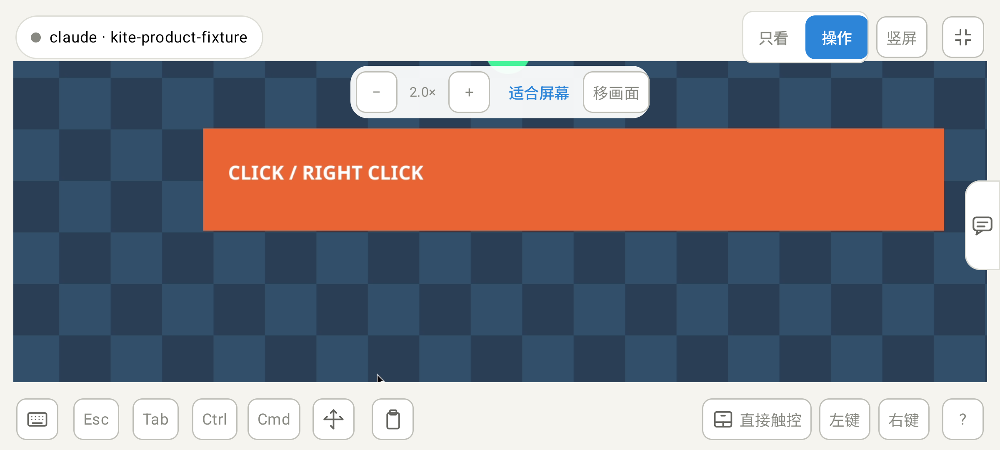
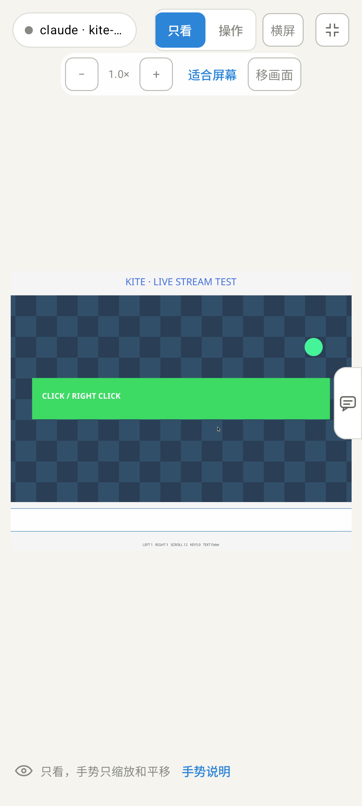
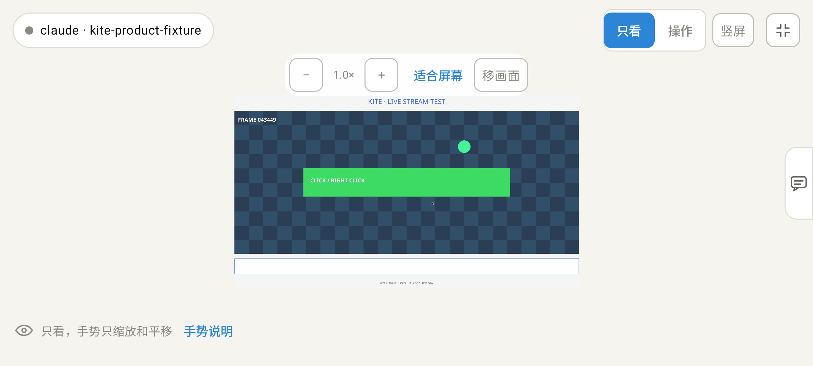
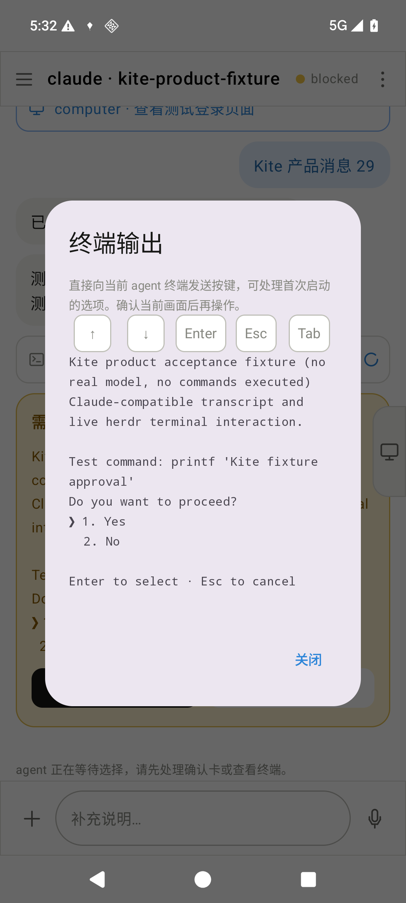

# Alpha 5 phone feedback fixes

The reported phone flow had several real client gaps: the connection form closed before the asynchronous SSH / herdr handshake completed; an empty agent list left the send button disabled without preparing a backend agent; there was no explicit orientation control; and operation-mode touch had no viewport zoom path. Those have been addressed under [RFC 0005](../../rfcs/0005-mobile-operation-and-session-entry.md).

The live host's herdr API returned an empty agent list during diagnosis. The user clarified that connecting the host should be enough to chat. The client now reuses the host agent or automatically prepares a persistent default Codex session; optional project sessions are secondary. The host now retains a real default `kite` backend after the test phone disconnects.

## Implemented behavior

- Host settings show SSH / herdr progress and keep failures visible, with diagnostic copying. A host with no agents automatically prepares the default `kite` Codex session in the host user home directory; reconnecting reuses it. Preparation failures have a retry action instead of a mandatory session picker.
- The phone creates a project workspace and starts Codex / Claude using real herdr APIs. Existing ordinary agents remain sendable: the managed-launch readiness flag is not a universal input gate. Terminal keys handle startup choices.
- Fullscreen opens landscape and exposes portrait / landscape controls independently of the system auto-rotation setting.
- Watch / Operate remain separate from agent pause. Both support local zoom. Render, inverse direct touch and relative motion share one source-pixel viewport. Move view pans without changing control mode or host resolution.
- Touchpad provides taps, double-tap / hold drag, two-finger right-click / scrolling, pinch zoom and explicit mouse buttons. Pinch does not also send a host click or wheel event.

## Verification

On an API 36 ARM64 emulator and actual Linux SSH / herdr / Sunshine services:

| Check | Observed result |
| --- | --- |
| Message | Chinese prompt reaches the controlled foreground agent through herdr and returns in its transcript; a real Codex connectivity request also receives the exact assistant reply `Kite 已连接` with no model tool calls |
| Persistent backend | A no-agent connection prepares the default backend. With the Kite Codex launch profile in place, hooks report its actual session identity and replies render as chat bubbles. Disconnect / reconnect preserves its foreground PID, terminal and provider session without creating another workspace |
| Session startup | New session in the app creates a distinct workspace and starts installed Codex to interactive-ready state; no prompt or model task is submitted, then the owned test workspace is closed |
| Operation zoom | Injected two-finger pinch changes scale to 2x with no host click, right-click or wheel event |
| Coordinate mapping | After 2x zoom and a phone viewport pan of (+120, -60), a touch at phone (1520, 558) reaches exactly desktop **(1100, 600)** |
| Input methods | Two-finger tap sends one right-click; parallel fingers scroll without a click; direct letterbox touches are ignored |
| Orientation | Both orientation buttons work with Android auto-rotation disabled |
| Media | Source and decoder stay 1920x1080; one decoder configuration across orientation changes and PiP return |
| Terminal | Down / Enter controls reach the selected controlled agent pane |
| Failed connection | A closed test SSH port shows an immediate translated reason and keeps settings open; correcting the port recovers without key or trust resets |

[Recorded results and unmodified screenshot hashes](phone-fixes/results.json). Desktop input and terminal-choice tests use labelled controlled fixtures and do not run their illustrative commands. Backend acceptance additionally starts installed Codex and makes a benign no-tools connectivity request. The default backend is intentionally retained for the user; temporary controlled agent / desktop resources are cleaned up.

Offline checks: **37 Rust tests**, seven Android viewport tests, Clippy with warnings denied, rustfmt, three publisher tests, workflow actionlint and ARM64 iOS simulator compilation. Tagged CI separately builds, lints and runs unit tests on the signed Android Release variant.

## Captures

