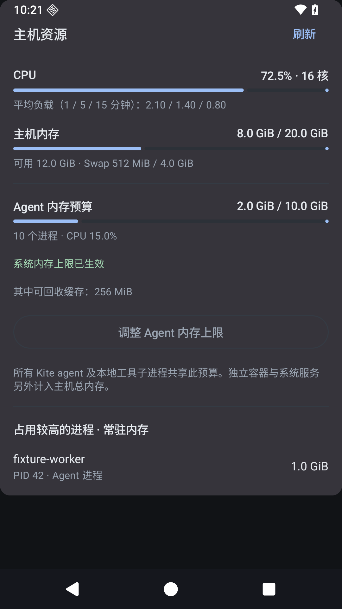
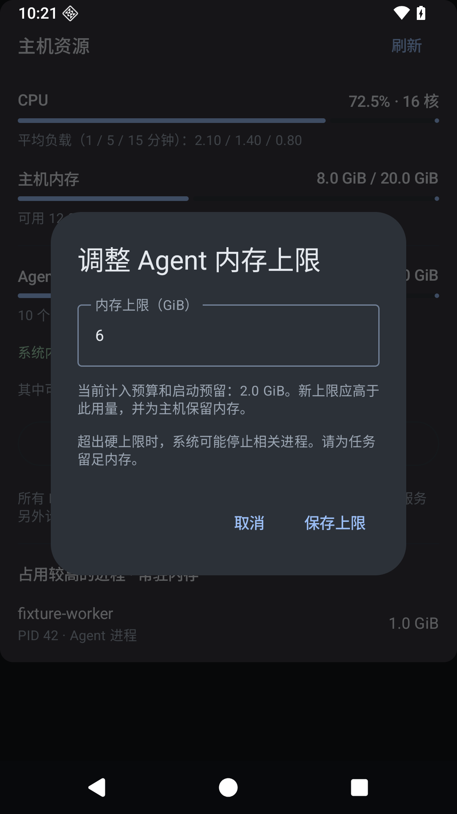
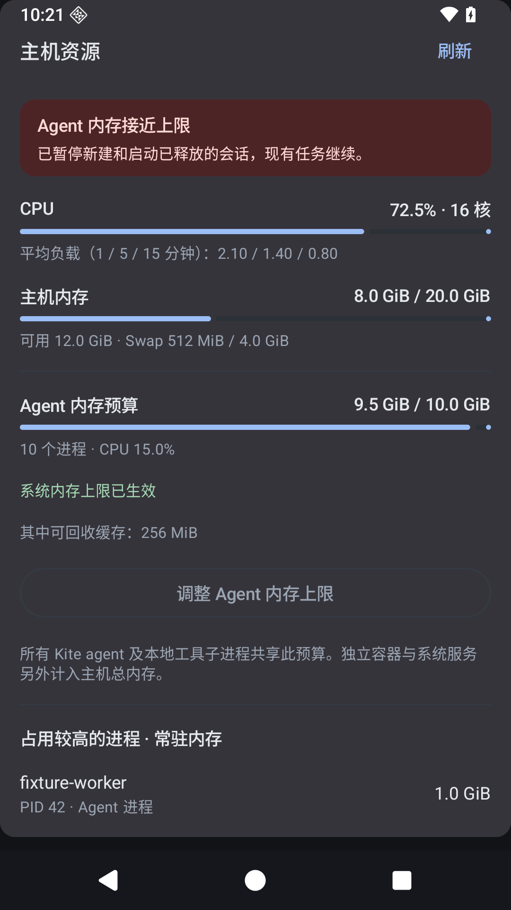

# 主机资源与共享内存预算

主机详情展示 CPU、负载、主机可用内存、Swap、Agent 预算和常驻内存进程；可编辑共享上限。聊天显示内存预警，后台使用真实 Android 系统通知。严重不足时服务器拒绝新启动；已有 owner 和历史保留。

## 已验证

- Rust 全 workspace 测试、Clippy，58 个 backend 测试、5 个 Linux 安装/打包测试通过。
- 73 个 Android JVM 测试、Android lint 和原生测试源码编译通过。
- 三个 API 36 原生测试通过：概览及准确的 GiB 编辑、严重压力/离线显示、真实 NotificationManager 投递。[原生记录](native-validation.json)。
- [隔离内核测试](kernel-budget-probe.json) 使用 64 MiB 总预算，核对旧分配预留加新内核上限等于预算，超额分配被该 cgroup OOM 终止。
- [SDK 进程测试](sdk-budget-smoke.json) 使用 DSH 协议夹具，初始化前进入独立资源 scope，逻辑引用保持一致，未提交模型 turn。
- [本机记录](host-validation.json) 确认 10 GiB 已生效、配置持久化、控制服务留在预算之外、节点身份保持，以及真实 CPU/内存采样。

原生测试展示数据为合成记录，没有把夹具称为真实模型回复。x86 UI harness 沿用临时 portable Reed–Solomon CPU header 处理现有 nanors/Clang 链接限制；发行 ARM64 媒体源码与优化配置保持适用。

## 展示

## 运行行为

本机预算为 `10737418240` 字节。已有进程的内存账目由迁移预留覆盖，旧进程退出后释放该预留；新分配由内核限制。独立容器和外部服务属于主机总量，另行展示。到达硬上限可能停止超额进程，历史保留；不自动重放任务。

验证中发现，低于硬边界的 `memory.high` 会使构建反复回收并长时间等待。实现采用提前预警、并发启动预留和硬上限，不将软节流设在预算以内。

## 发布

[Alpha 46](https://github.com/wenshiqi0/Kite/releases/tag/v0.2.0-alpha.46) / versionCode 48 已公开发布，源码 `898a659d2550445ab1fdb90e2dfccda01f3b4408`。main 与标签 CI 均通过；公开 APK/兼容包校验和、稳定证书与 16 KiB 对齐独立核验通过。匹配的 CI Linux 包已安装，运行二进制与公开 manifest 一致，原节点身份与 10 GiB 限额保持。[发布记录](published-release.json)。
