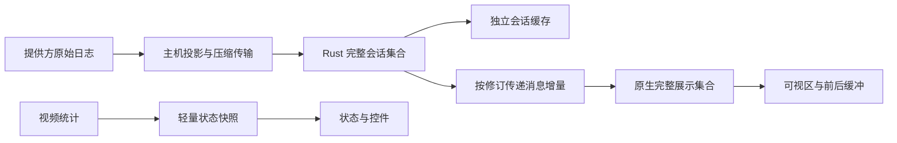

# RFC 0013：完整会话数据、虚拟渲染与深色桌面工作区

> 状态：已实现，Alpha 13 · 2026-10-31

用户明确要求：数据完整保留，渲染只创建可视窗口和冗余；全屏恢复参考图的鼠标展示，触控板只在上下分屏；全界面使用深色配色。

## 问题与证据

Alpha 12 的 [数据窗口](https://github.com/wenshiqi0/Kite/blob/v0.2.0-alpha.12/crates/kite-app/src/core/conversation.rs) 会清空最新页、淘汰超过 300 条／256KiB 的数据。[列表](https://github.com/wenshiqi0/Kite/blob/v0.2.0-alpha.12/android/app/src/main/java/io/github/wenshiqi0/kite/ui/KiteWorkspace.kt) 同时管理网络翻页、滚动锚点和跟随最新。使用 LazyColumn 没有消除这层数据裁剪和定位竞态，650 条样本的通过也不足以代表真实长会话交互验收。

本 RFC 取代 RFC 0012 的前端分页窗口方案，并调整 RFC 0011 的全屏展示；竖屏桌面 → 触控板 → Chat → 输入框的顺序保留。

## 数据与渲染分离

1. 原始提供方文件保持不变。后台同步自动读取完整记录并补齐断线期间的中间缺口；按主机、提供方会话和连接代次隔离并取消过期任务。滚动不再发起历史 SSH 请求。
2. 删除解析器与 Core 的会话条数、总字节窗口裁剪，重复文本但不同 ID 的消息必须保留。使用源记录位置排序，跨传输批次合并工具调用和结果。传输位置不参与消息 ID，保留既有身份。
3. 无缓存的长会话在完成初次同步后一次发布完整集合；已有缓存持续可读。后台同步失败保留内容，并提供明确重试；不把来源错误或大记录静默当作完整空历史。
4. 主机辅助程序安装为 backend-v4.py。批次使用 gzip，单次解压结果最多 4MiB，普通批次约 1MiB；这是传输边界，不是会话大小限制。超过单条记录传输边界时明确失败，不跳过。正在使用的 v3 服务与 owner 不被替换。
5. 状态快照只含会话上下文、内容修订、数量及同步状态，不带消息正文。消息通过独立增量接口传递插入／替换／删除范围；错过修订或切换上下文时重置镜像。Rust 用共享引用持有不可变消息，统计更新不克隆整个历史。
6. 原生层维护只读展示集合与稳定工具分组。普通尾部变化只替换受影响行。LazyColumn 采用前一屏、后半屏缓存，不预先创建整段消息视图；长工具输出也拆成有界文字块并虚拟渲染。
7. 滚动位置、跟随最新、手势和布局留在原生层。用户触摸或浏览时停止自动追尾；回到最新是本地滚动，不替换数据。移除旧的前端翻页和 Core 跟随命令，不保留旧 FFI 入口。

## 持久化与兼容面

沿用用户已确认的保留历史、主机、设备身份、SSH 信任及配对，后端与 APK 同步升级、FFI 同次生成。旧 sessions 文档中的缓存先迁移为独立原子会话缓存，再移除内联副本；不得丢弃消息。目录、归档和选中会话仍保留。只淘汰内存缓存，不删除已保存的其他会话文件；正文持久化按会话执行并合并短时间内的更新。

## 全屏与分屏

- 全屏：右侧轻量操作栏；独立鼠标形状的左右键和中央滚轮，下方是移动控件位置的手柄，不是触控板。收起为小鼠标图标。直接触摸、缩放、平移和源坐标逆变换保留；操作不会自动暂停 agent。
- 触控板仅在上下分屏桌面下方展开，聊天与输入框仍在其下方；关闭后归还空间。
- 深色配色集中管理，覆盖 Compose、原生 Markdown、代码、表格、侧栏、主机卡、提问／审批、弹窗、状态栏和启动背景；不改变远端桌面自身的配色。

## 验证要求

- 一万条完整消息与超出旧文本上限的内容，无裁剪、无重复丢失，能从缓存重新打开。
- 视频统计更新不改变消息修订和对象；一条尾部变化只跨 FFI 传这一条。
- 对真实 Android 视图树计数，验证一万条数据只创建可视区和缓冲所需的富文本视图；连续滚动与新输出不抢位置。
- 验证 3MiB 工具输出、跨批次工具结果、稳定分组、晚到响应隔离、存储迁移及失败保留。
- 用真实 APK 截图与操作验证深色界面、全屏鼠标和分屏触控板。CI、模拟器、发布安装与真实手机体验分别记录。

实现与受控验证记录见 [完整会话与深色工作区验收](../product/2026-10-31/complete-transcript/acceptance.md)。

## Alpha 14 指针修正

Alpha 13 只有鼠标形状的控件，手柄仅移动控件，按钮依赖上次触屏的位置。用户确认这不符合参考图。Alpha 14 展开时在视频上方绘制独立箭头，热点保存在源桌面像素中；手柄移动与按住按钮拖动都移动该热点。左右键、辅助点击和滚轮在发出前先同步同一个热点，不使用按钮或手指的屏幕位置。画面触屏同样更新热点。缩放、平移与布局用既有 DesktopViewport 正逆变换，纯视口手势不发远端输入；移出可视区的本地热点收至可视边界，下一次操作才同步。收起图标仅移动入口；展开控件到边缘不会限制指针继续移动。触控板仍只在上下分屏提供。此修正不改变存储、后端或 FFI，沿用已确认的身份与历史保留要求。

## Alpha 15 控件与主机列表

鼠标主体缩至 104×112 dp，箭头高度为 20 dp。滚轮上下半区点按各滚动一格，拖动保持连续滚动；按压高亮与方向提示配合系统触觉反馈，滚动刻度反馈按已发送的滚动量累积并限频。取消、额外手指或模式切换不得补发点击或滚动。原生手势和触觉属于现有平台输入边界，不增加后端或 FFI 协议。

主机卡片只显示名称、真实连接状态和连接／进入／重试入口；编辑独立，账号、端口、公钥与诊断在编辑或连接设置中按需查看。未连接不代表不可达，不以保存配置推断在线。历史、身份、配对、主机配置及剪贴板偏好的保存格式不变。
