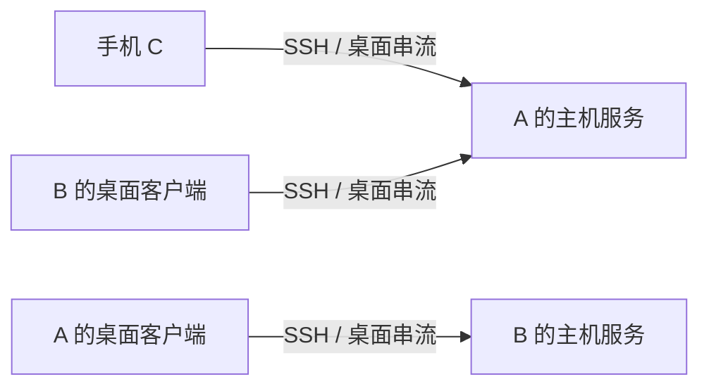

# RFC 0015：桌面客户端与主机双角色

> 状态：已采纳（产品与架构约束；桌面客户端待实现） · 2026-11-01

## 需求与当前实现

用户确认：桌面端同时作为客户端和服务端，可以连接本机以外的 Kite 桌面端。此需求适用于 Linux 与 macOS，不把桌面产品限定为手机的后端。

Alpha 23 已交付 RFC 0014 的 Linux 主机节点、状态面板和托盘。`desktop/linux/desktop.py` 目前只调用本机节点 CLI，没有远程机器选择、远程聊天或视频解码界面；`kite-ffi::core_bridge::media_sink` 在非 Android 平台仍返回 `MediaUnavailable`。已有手机客户端和主机面板不能作为桌面客户端完成的证据。

## 同一应用的两种角色

| 角色 | 能力 | 生命周期 |
| --- | --- | --- |
| 客户端 | 保存和编辑其他机器；通过 SSH/Tailscale 连接目标节点；访问会话、历史、聊天、审批和模型问题；观看或操作目标桌面 | 断开目标只结束本机到该目标的连接，释放远端输入，不停止目标 agent |
| 本机主机 | 管理本机节点、Herdr、Sunshine 和 MCP，向手机及其他桌面客户端提供服务 | 后台节点独立运行；关闭客户端窗口或断开外连不结束本机服务 |

两种角色能够同时运行。例如 A 的桌面客户端连接 B，同时 A 仍向手机 C 提供服务。纯客户端使用不得以本机 Herdr、Sunshine 已安装或运行作为前提；远程目标提供它们即可。

## 原生界面

- 主窗口提供机器列表和所选机器的工作区；卡片只显示名称、实际连接状态及连接/进入操作，详情与编辑独立。
- 工作区包含目标机器、会话目录、聊天和远程桌面。桌面宽度允许聊天与视频并排，支持全屏观看和操作、缩放平移、物理键鼠与可选剪贴板同步。
- 本机服务状态与远程连接状态分别展示；本机管理通过独立面板和托盘进入，不能用本机 `ready` 表示目标机器已连接。
- 操作与 agent 暂停独立。默认观看不发送输入；输入映射使用源桌面坐标，关闭或失焦释放已按状态。沿用固定 16ms 指针/滚轮窗口及 200ms 已提交文字窗口。
- 切换目标时，原目标的历史与连接信息保留；会话、附件、问题与审批始终关联明确的目标机器，不能因界面切换误发给另一台。

## 实现边界与已有数据

客户端复用 `kite-app` 的连接、身份/信任、会话、聊天和 Sunshine 编排，原生通过 `kite-ffi` 使用命令与快照。桌面媒体通过独立的原生通道适配，视频和高频输入不走 UniFFI。不得在原生层再实现一套 SSH、会话持久化或主机协议。

本机节点配置和客户端的远程主机目录各有明确用途。保留现有节点 ID、设备身份、主机信任、配对、历史和 provider owner；不把另一设备的私钥复制为桌面身份。具体存储或 API 如需迁移，须按 AGENTS.md 先确认新增兼容面，不预加旧接口回退。本 RFC 不修改现有 API、存储格式、依赖或媒体 ABI。

主机角色仍遵循 RFC 0014。跨机器模型任务和消息投递属于后续 MCP 协作能力；能远程聊天或观看桌面不等于已经实现持久的模型互通。

## 验收与推进顺序

1. 先补齐 Linux 桌面客户端，再实现 macOS 原生客户端及主机适配；两平台均属于产品范围，逐个平台记录实际交付状态。
2. 使用两个独立节点，验证 A 保存/编辑 B、信任目标、重新连接，以及 B 的会话恢复、历史、消息、问题与审批；不能仅连接本机冒充跨机验收。
3. A 实际解码 B 的视频，记录源分辨率、实际显示 FPS 和延迟；点击、拖动、滚轮和文字须在 B 的受控窗口到达并可见。区分 LAN、Tailscale 和物理机器结果。
4. A 外连 B 时，C 仍可访问 A；分别断开远端桌面、SSH 和退出客户端，验证本机节点与原有 agent 服务继续运行。
5. 验证纯客户端可在本机主机服务未启用时连接 B；断线、目标切换和失败后没有输入残留或跨机消息误投。

未通过这些验收前，桌面客户端标为待实现，不以托盘、CLI、MCP 查询或手机连接成功替代。
